<div align="center">

# WaterBuddy: Your Daily Hydration Companion
### *Simple, Calibrated Hydration Tracking & Visual Habit Companion*

[](https://waterbuddy-parth-gajera.streamlit.app/)
[](https://www.python.org/)
[](https://streamlit.io/)
[](https://altair-viz.github.io/)
[]()
[]()

</div>

> **Course:** Artificial Intelligence: Real-World Applications & Implications  
> **Course Code:** `IDAI 102` (Python Programming)  
> **Assignment Title:** Design 'WaterBuddy': Your Daily Hydration Companion  
> **Type of Assessment:** Formative Assessment 2 (FA-2: Developing and Deploying App Using Python)  
> **Scenario Track:** WellNest Technologies Pvt. Ltd. | Hydration Habit System  
> **Student Developer:** Parth Pravinbhai Gajera (Candidate ID: `1000544`)  
> **Project Partner:** Subhan Syed  
> **School / Institutional Partner:** Aspee Nutan Academy / WACP International  
> **Foundational Planning Atlas:** [Canva Visual Atlas ID: DAHars3Lfk4](https://www.canva.com/design/DAHars3Lfk4/1NikvoNTGVTVM2JzmDzuBQ/edit)  
> **Live Interactive Application:** [https://waterbuddy-parth-gajera.streamlit.app/](https://waterbuddy-parth-gajera.streamlit.app/)  
> **GitHub Repository URL:** [https://github.com/parthibcpana/IDAI102-1000544-PARTH-PARVINBHAI-GAJERA](https://github.com/parthibcpana/IDAI102-1000544-PARTH-PARVINBHAI-GAJERA)

---

## Table of Contents

1. [Project Purpose & Student Learning Journey](#1-project-purpose--student-learning-journey)
2. [Intended Learning Outcomes: Knowledge Acquired & Practical Evidence](#2-intended-learning-outcomes-knowledge-acquired--practical-evidence)
3. [Problem Understanding & Clinical Hydration Baselines (WHO / EFSA)](#3-problem-understanding--clinical-hydration-baselines-who--efsa)
4. [System Architecture & Core Logic Flow](#4-system-architecture--core-logic-flow)
5. [Interface Architecture & Live Screenshot Gallery](#5-interface-architecture--live-screenshot-gallery)
6. [Animated Fluid Chamber & Companion Coach Engine](#6-animated-fluid-chamber--companion-coach-engine)
7. [Five Companion Spirit Mascots & Reactive States](#7-five-companion-spirit-mascots--reactive-states)
8. [Cloud-Safe Headless Turtle Vector Art Vault (Pillow)](#8-cloud-safe-headless-turtle-vector-art-vault-pillow)
9. [Living Wall of Badges & Habit Milestones](#9-living-wall-of-badges--habit-milestones)
10. [Rapid Vessel Logging, Cup Converter & Hydration Ledger](#10-rapid-vessel-logging-cup-converter--hydration-ledger)
11. [Verification & Multi-Scenario Test Proof](#11-verification--multi-scenario-test-proof)
12. [Deployment & Local Installation Guide](#12-deployment--local-installation-guide)
13. [System Standards & Technical Alignment](#13-system-standards--technical-alignment)
14. [Academic Integrity Statement](#14-academic-integrity-statement)

---

## 1. Project Purpose & Student Learning Journey

WaterBuddy transforms our FA-1 conceptual storyboard into a live, privacy-first Streamlit web app that helps people track daily water intake without noisy alarms or generic "8 glasses for everyone" rules. Users set an age-calibrated daily fluid target, log drinks in one click via real container cards or the first-view `+ Log Drink` modal, watch their companion spirit and animated water chamber respond live, and collect custom vector badges and artwork.

### What We Built Around the User Brief
1. **Age-Calibrated Baselines:** Instead of a one-size-fits-all target, WaterBuddy tailors daily fluid goals across four age groups (Kids, Teens, Adults, Seniors) with an adjustable fine-tuner.
2. **Low-Friction First-View Logging:** A prominent `+ Log Drink` button at the top right lets any returning user record a drink immediately without scrolling past charts.
3. **Calm Visual Feedback:** Pure CSS fluid wave motion, subtle droplet dividers, and five expressive mascot companions replace nagging push alerts.
4. **Cloud-Safe Procedural Art:** Standard Python `turtle` crashes on Linux cloud servers lacking a display (`TclError: no display name`), so we built an in-memory `HeadlessTurtle` engine on Pillow.

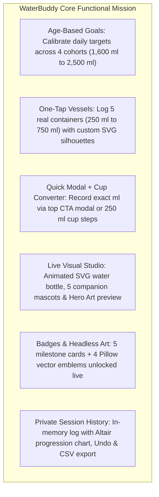

---

## 2. Intended Learning Outcomes: Knowledge Acquired & Practical Evidence

| Intended Learning Outcome | What I Learned | How I Applied It in WaterBuddy |
| :--- | :--- | :--- |
| **ILO 1: Modular Python Applications** | Breaking formatting, calculations, graphics, and UI state into small helper functions makes debugging and UI refreshes far faster. | Structured [app.py](app.py) into discrete helpers (`calculate_progress`, `render_coastal_spring_svg`, `render_animated_bottle_svg`, `HeadlessTurtle`, `draw_vector_art`, `evaluate_badges`, `log_drink`, `open_custom_drink_dialog`). |
| **ILO 2: Real-Time Data Processing** | Storing structured intake dictionaries inside `st.session_state` keeps totals, Altair charts, badge thresholds, and undo actions synchronized automatically. | Built an instant `intake_history` list storing `id`, `time`, `vessel`, `amount`, and cumulative `running_total` so KPI cards, Altair timeline & consistency charts, and the ledger update together. |
| **ILO 3: Interactive Streamlit Web Interface** | A calm, cohesive color token table, modal dialogs, and `.streamlit/config.toml` prevent harsh contrast clashes across light mode, dark mode, and mobile screens. | Configured Coastal Oasis Light default + Deep Tide Dark toggle, top-bar `+ Log Drink` `@st.dialog` modal, equal-height 3-panel Hero Studio, and `@media (max-width: 920px)` phone stacking. |
| **ILO 4: Creative Visual Elements** | Base64-encoded SVG art and Pillow trigonometric turtle geometry eliminate OS display dependencies and render crisply across Windows, macOS, and cloud Linux. | Created a panoramic coastal waterfall welcome scene with hiker man and sea turtle, bespoke SVG vessel and badge icons, and a 4-piece `HeadlessTurtle` art vault. |
| **ILO 5: Public Cloud Deployment** | Pinning minimal libraries in `requirements.txt` and shipping `.streamlit/config.toml` keeps cloud builds fast and theme-accurate on first visit. | Deployed `app.py`, `requirements.txt`, and `.streamlit/config.toml` publicly on [Streamlit Community Cloud](https://waterbuddy-parth-gajera.streamlit.app/). |

---

## 3. Problem Understanding & Clinical Hydration Baselines (WHO / EFSA)

Generic reminders tell a 9-year-old child, an office adult, and a senior over 65 to drink the exact same 2,000 ml target. From observing friends, students, and older family members, we noticed two practical gaps: busy people forget how much their own bottle holds (`350 ml` tumbler vs. `750 ml` flask), and older adults often ignore mild thirst until fatigue or headaches start. WaterBuddy maps age cohorts from World Health Organization (WHO) and European Food Safety Authority (EFSA) guidance directly onto everyday container sizes.

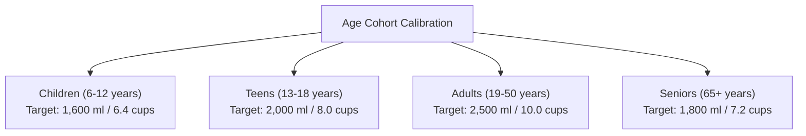

### 3.1 Age Cohort Reference Matrix

| Age Cohort | Baseline Goal | Equivalent Cups (250 ml) | Practical Hydration Context |
| :--- | :---: | :---: | :--- |
| **Children (6 to 12 years)** | **1,600 ml** | 6.4 cups | Active kids lose fluids quickly during play and school sports, needing smaller frequent refills. |
| **Teens (13 to 18 years)** | **2,000 ml** | 8.0 cups | Growth spurts and afternoon classes call for steady water intake to avoid late-day fatigue. |
| **Adults (19 to 50 years)** | **2,500 ml** | 10.0 cups | Counters dry air-conditioned offices and long screen hours where even mild dehydration causes brain fog. |
| **Seniors (65+ years)** | **1,800 ml** | 7.2 cups | Natural thirst signals soften with age, so steady routine sipping protects energy and kidney comfort. |

---

## 4. System Architecture & Core Logic Flow

Whenever a user clicks a vessel button, submits the `+ Log Drink` modal, or uses the Cup Converter, one shared `log_drink()` pipeline updates totals, redraws the fluid chamber, shifts companion mood, updates Altair chart data, and unlocks badges and vector artwork.

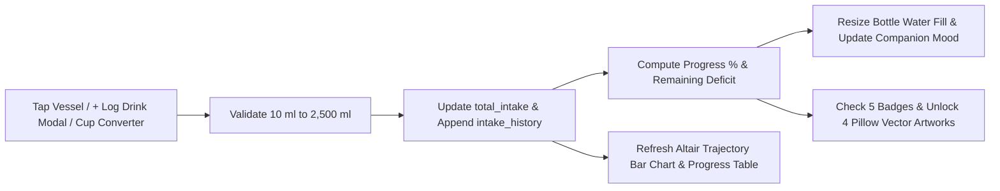

### 4.1 Simple Formulas & Real-World Examples

Every formula runs directly in Python inside `calculate_progress()` and `render_animated_bottle_svg()` with transparent numbers:

1. **Daily Progress Percentage:**  
   `Progress % = (Logged ml / Daily Goal ml) x 100`  
   *Example:* Logging `1,100 ml` out of a `2,500 ml` adult goal equals `(1100 / 2500) x 100 = 44.0%`.

2. **Remaining Water Needed:**  
   `Remaining ml = max(0, Daily Goal ml - Logged ml)`  
   *Example:* At `1,100 ml` logged toward `2,500 ml`, you have `1,400 ml` remaining (about `5.6` standard 250 ml cups).

3. **Cup-to-Milliliter Conversion:**  
   `Added ml = Cups x 250`  
   *Example:* Sliding the Cup Converter to `1.5` cups converts immediately to `375 ml`.

4. **SVG Fluid Fill Height:**  
   `Fill Height (px) = (min(100, Progress %) / 100) x 195` and `Water Top Y = 248 - Fill Height`  
   *Example:* At `44%`, water rises `85.8 px` inside the `195 px` glass chamber (`Y = 162.2`), keeping percentage text legible at every height.

### 4.2 Session State Schema (`st.session_state`)

```python
st.session_state = {
    "onboarded": bool,           # Separates Welcome Landscape from the Main Dashboard
    "dark_theme": bool,          # False = Coastal Oasis Light (default), True = Deep Tide Dark
    "nav_view": str,             # "Dashboard" | "Wall of Badges" | "Vessel Studio"
    "user_name": str,            # Personalized greeting and sidebar header name
    "user_avatar": str,          # Selected companion key from COMPANIONS
    "age_cohort": str,           # Selected age bracket from AGE_GOALS
    "daily_goal": int,           # Personalized daily volume target in ml
    "total_intake": int,         # Running cumulative water total for today
    "intake_history": list,      # [{"id", "time", "vessel", "amount", "running_total"}]
    "recent_art": str | None,    # Latest earned HeadlessTurtle key ("drop"|"traveler"|"leaf"|"badge")
    "mascot_mood": str,          # "start"|"attentive"|"happy"|"energized"|"ecstatic"|"paced"|"caution"
    "show_reset_confirm": bool,  # Two-step daily reset guard flag
}
```

---

## 5. Interface Architecture & Live Screenshot Gallery

WaterBuddy follows our 5-screen Canva Visual Atlas (`DAHars3Lfk4`) across an onboarding gateway and three live sidebar-switchable views:

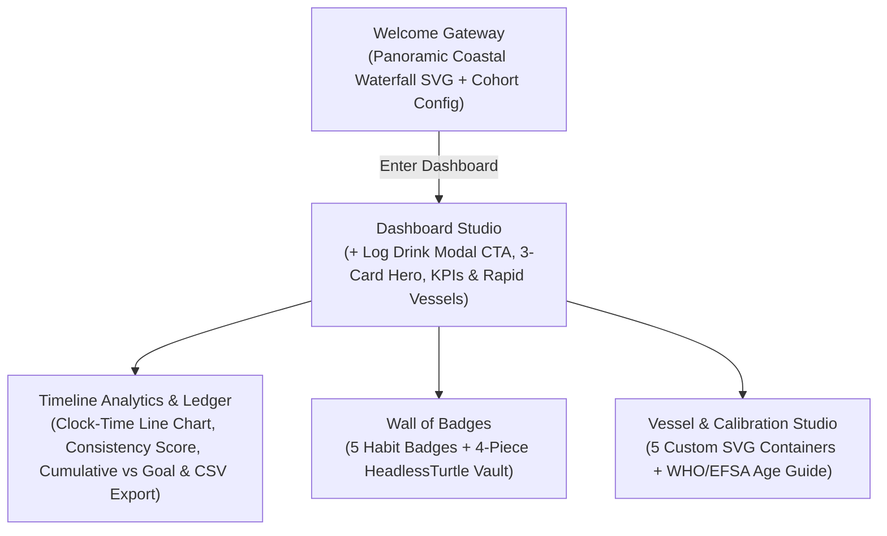

### 5.1 Welcome & Onboarding Landscape (`onboarding_v3.png`)
The opening screen pairs a custom base64-encoded coastal waterfall SVG scene (featuring alpine ridges, animated cascading falls, coastal coral lighthouse, reeds, a hydrated hiker holding a teal bottle, and HydroBuddy the Sea Turtle) with cohort calibration, companion selection, and a live 7-situation expression previewer.

<div align="center">
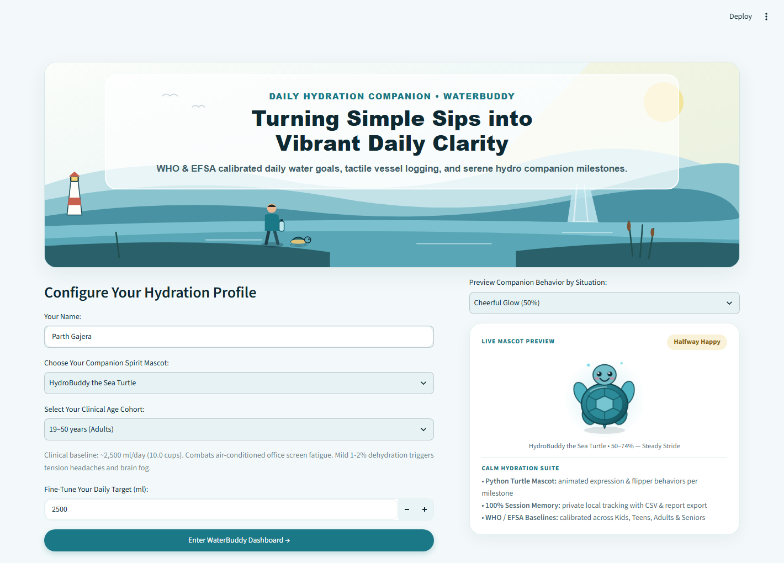
<p><em>Figure 1: Coastal Oasis Light welcome screen with animated waterfall horizon art, Python-Turtle Sea Turtle live expression previewer, and cohort calibration.</em></p>
</div>

### 5.2 Main Dashboard Studio Light Mode (`dashboard_v3.png`)
The top action bar keeps the primary `+ Log Drink` button in first view alongside synced tab pills (`Dashboard`, `Badges`, `Vessels`), above an equal-height 3-panel Hero Studio (`Fluid Chamber`, `Companion Coach`, `Hydro Art Vault`), four KPI cards, and 3D container logging chips.

<div align="center">
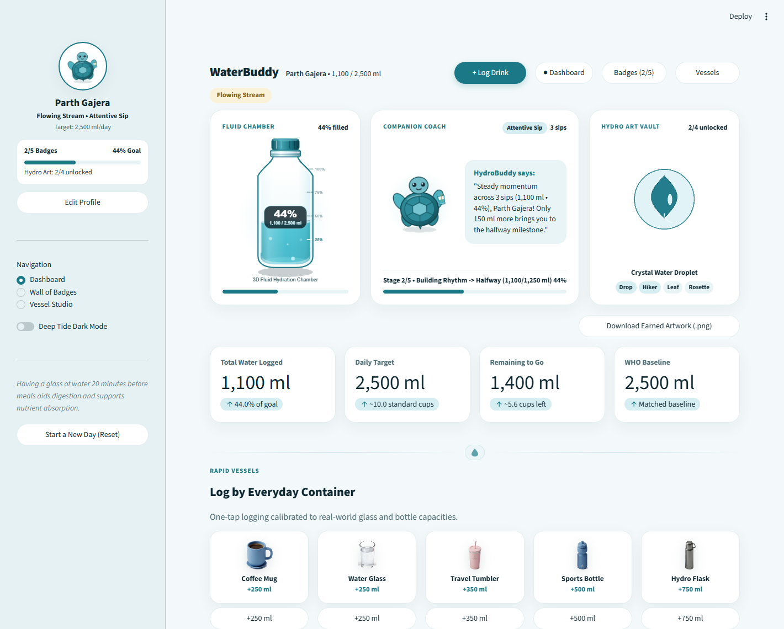
<p><em>Figure 2: Coastal Oasis Light Dashboard showing the 3D animated glass Fluid Chamber, reactive sipping HydroBuddy Turtle with mood badge, Hydro Art Vault, 4 KPI metrics, and 3D vessel cards.</em></p>
</div>

### 5.3 Deep Tide Dark Mode at 105% Goal (`dashboard_dark_v2.png`)
Toggling Deep Tide Dark Mode adapts every card surface, divider ornament, Altair chart axis, modal dialog, and 3D glass reflection cleanly to low-glare coastal slate (`#101B21`), while showing HydroBuddy's Python-Turtle golden shell trim, floating gold crown, aviator sunglasses, and the Ocean Championship Rosette.

<div align="center">
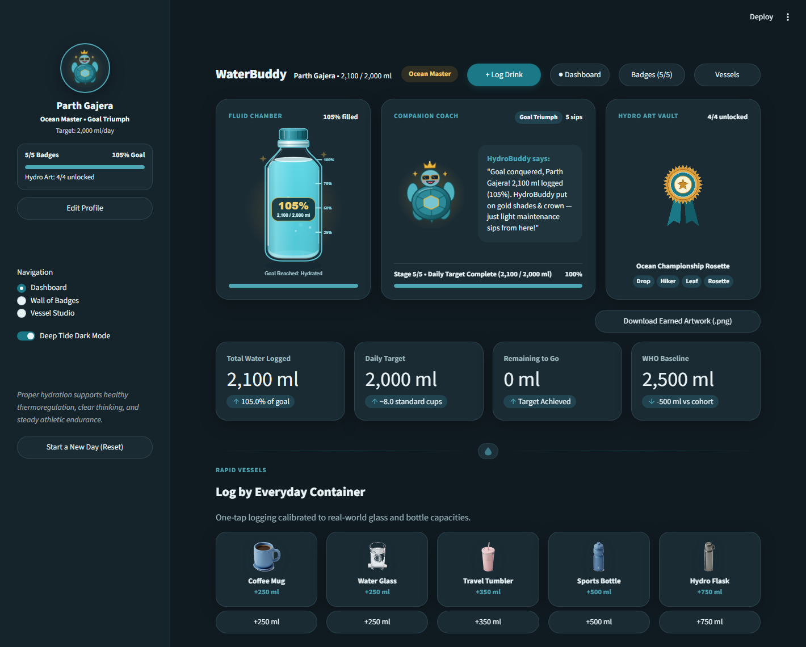
<p><em>Figure 3: Deep Tide Dark Mode showcasing 105% 3D bottle fill with goal sparkles, ecstatic companion crown & shades state, and Ocean Championship Rosette reward.</em></p>
</div>

### 5.4 Wall of Badges & Hydro Art Collector Vault (`badges_v3.png`)
Unlocked milestones illuminate in deep coastal teal (`#1A7887`) with 3D trophy emblems alongside the 4-piece Pillow `HeadlessTurtle` Collector Vault (`Crystal Droplet`, `Spring Hiker & Turtle`, `Hydration Sprout`, and `Ocean Rosette`).

<div align="center">
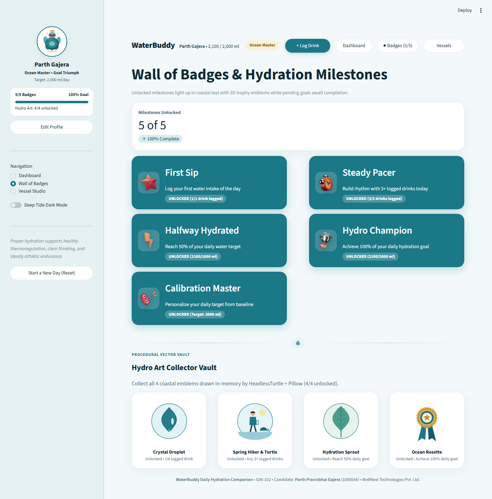
<p><em>Figure 4: Living Wall of Badges at 5 of 5 Complete with 3D trophy emblems plus all 4 unlocked procedural artworks rendered in-memory by HeadlessTurtle + Pillow.</em></p>
</div>

### 5.5 Vessel & Hydration Calibration Studio (`vessel_studio_v2.png`)
Interactive studio featuring a 3D vessel lineup banner, five clickable 3D beverage containers (`Coffee Mug`, `Water Glass`, `Travel Tumbler`, `Sports Bottle`, `Hydro Flask`), and 3D age cohort persona cards with one-click goal calibration.

<div align="center">
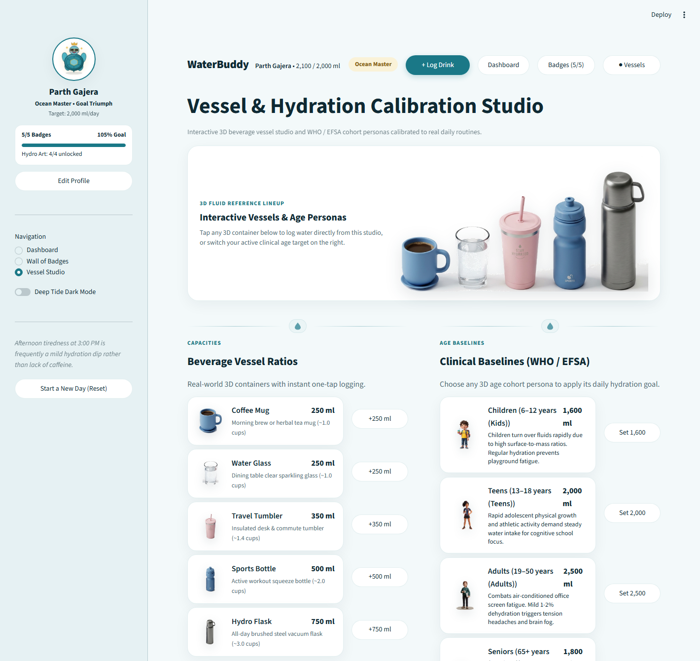
<p><em>Figure 5: Interactive 3D Vessel & Hydration Calibration Studio with one-tap container logging and WHO / EFSA cohort persona cards.</em></p>
</div>

---

## 6. 3D Animated Fluid Chamber & Companion Coach Engine

In place of flat horizontal progress bars, WaterBuddy pairs two synced hero modules inside an equal-height CSS grid (`studio-grid`):

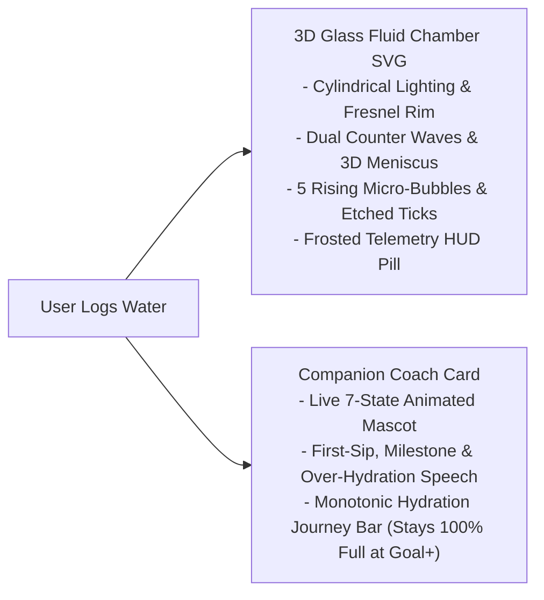

1. **3D Cylindrical Glass & Reflections:** Layered glass wall highlights, crystal base prism, right rim bounce sheen, and a brushed-teal grooved screw cap enclose the clipped liquid chamber (`<clipPath id="..._clip">`).
2. **Dual Counter Waves & 3D Meniscus:** Counter-flowing foreground/background sine waves (`wb-wf` / `wb-wb`), a gently breathing elliptical top water meniscus (`wb-men`), and 5 staggered rising bubbles animate cleanly without JavaScript timers.
3. **Laser-Etched Ticks & HUD Capsule:** Engraved `25%`, `50%`, `75%`, and `100%` graduation marks illuminate as the water rises past each mark beside an unobstructed high-contrast HUD capsule (`44%`, `1,100 / 2,500 ml`), switching cleanly to golden surplus (`125%` to `149%`) and amber guardrail warnings at `150%+` or `>4,500 ml`.

---

## 7. Five Companion Spirit Mascots & Situational Behaviors

All five companions animate dynamically across **seven live situational expressions**, updating posture, limb motion speed, eyes, mouth, and props directly from hydration progress, first-sip excitement, user actions (`log`, `undo`, `reset`, `goal_change`), and over-hydration thresholds without resetting progress back to zero after goal completion:

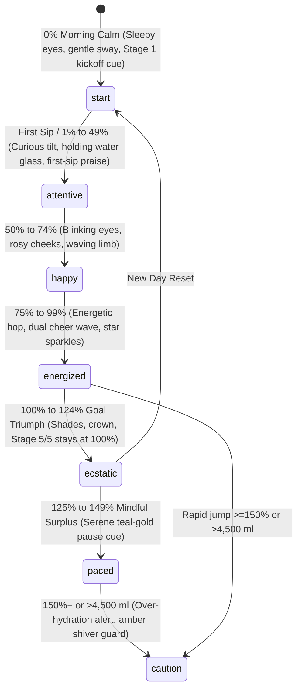

| Companion Name | Character & Animation Build | Hydration Encouragement Focus |
| :--- | :--- | :--- |
| **HydroBuddy the Sea Turtle** | Driven directly by Python `HeadlessTurtle` vector geometry (`trace_oval_svg_pts`, `trace_turtle_shell_scutes`) with animated flippers & blinking eyes | Wise ocean navigator focused on calm, steady sipping rhythm |
| **Bubbles the Playful Dolphin** | 3D-shaded teal dolphin with swept dorsal crest, wagging tail fluke & waving pectoral fins | High-energy celebrator for rapid multi-drink streaks |
| **Splash the River Otter** | Warm caramel otter with pink ears, whiskers, waving paws & glowing water pearl (gold at 100%) | Consistent mover encouraging regular hourly refills |
| **Misty the Friendly Raindrop** | Glossy liquid-gradient elemental teardrop with animated droplet hands & shimmer aura | Gentle reminder of steady focus and temperature balance |
| **Pippin the Polar Penguin** | Slate tuxedo penguin with coastal-teal scarf & flapping wings | Refreshing fan of chilled water bottles and recovery |

---

## 8. Cloud-Safe Headless Turtle Vector Engine (SVG + Pillow)

Because Python's standard `turtle` library opens a native desktop `tkinter` window, importing it on Linux cloud hosting immediately throws:
```text
_tkinter.TclError: no display name and no $DISPLAY environment variable
```
Our custom `HeadlessTurtle` class mirrors `forward`, `left`, `right`, `penup`, `pendown`, `goto`, and `arc` trigonometry both into **animated SVG path coordinates** (powering HydroBuddy's hexagonal carapace ribs, flippers, and star geometry) and onto an in-memory `280x280` `PIL.Image` RGBA canvas generating four downloadable coastal emblems:

| Artwork Key | Artwork Title | Unlock Requirement | Procedural Geometry |
| :--- | :--- | :--- | :--- |
| `drop` | **Crystal Water Droplet** | Log your 1st drink | Smooth multi-point teardrop outline with coastal teal refraction arc |
| `traveler` | **Spring Hiker & Turtle** | Log any 2+ drinks today | Minimalist lakeside walker carrying an insulated bottle with turtle companion |
| `leaf` | **Hydration Sprout** | Reach 50% of daily goal | Symmetrical botanical sprout leaf with central stem and angled side veins |
| `badge` | **Ocean Championship Rosette** | Reach 100% of daily goal | 64-vertex scalloped sunburst medal with twin swallowtail ribbons and star core |

---

## 9. Living Wall of Badges & Habit Milestones

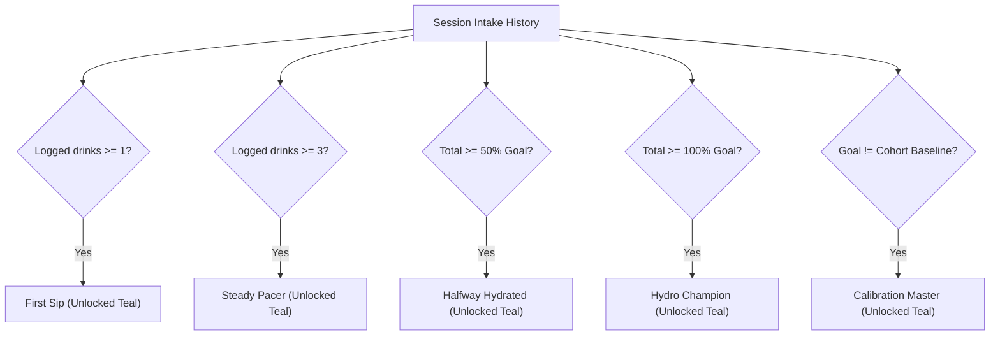

Every badge evaluates live against `intake_history`, illuminates in coastal teal (`#1A7887`) with 3D trophy emblems (`render_badge_svg`) once earned, and gracefully returns to muted gray lock tiles when resetting the day.

---

## 10. Rapid Vessel Logging, Cup Converter & Hydration Ledger

1. **One-Tap 3D Rapid Vessels:** Five uniform cards with 3D container assets (`Coffee Mug 250 ml`, `Water Glass 250 ml`, `Travel Tumbler 350 ml`, `Sports Bottle 500 ml`, `Hydro Flask 750 ml`).
2. **First-View `+ Log Drink` Modal:** Clicking `+ Log Drink` in the top navigation bar opens `@st.dialog("Log Custom Water Intake")` to record any custom volume (`10` to `2,500 ml`) and custom beverage label immediately.
3. **Aligned Precision Steppers & Cup Converter:** Twin bordered cards pair a custom milliliter form (`10` to `2,500 ml`) right next to a live Cup Converter (`0.5` to `15.0` cups multiplied cleanly by `250 ml`).
4. **Intake Timeline Line Graph, Consistency Analytics & Chronological Ledger:** Pairs an Altair clock-time Intake Timeline chart (showing exact logged times, volumes, Period color coding, drop stems, and mean sip rule) with tabbed **Pacing & Consistency** (`Morning` / `Afternoon` / `Evening` distribution vs balanced `goal / 3` target) and **Cumulative vs Goal** views, plus rhythm KPI cards (`Sip Frequency`, `Rhythm Consistency %`, `Peak Single Intake`), a full chronological `ProgressColumn` dataset, one-click `Undo Last Drink`, `Export Intake CSV`, and guarded daily reset confirmation.

---

## 11. Verification & Multi-Scenario Test Proof

We verified end-to-end state changes (`AppTest` automated assertions covering onboarding, all 5 vessels, custom form, cup converter, undo rollback, Deep Tide Dark toggle, modal opening, badge counts, vessel studio, and sidebar/header navigation sync) plus a full `5 mascots x 7 moods` visual matrix and headless Chrome desktop (`1420px`) & mobile (`412px`) captures.

| Test Case | Setup / Action | Logged Total | Progress & Rank | Badges Unlocked | Hydro Art Unlocked |
| :--- | :--- | :---: | :---: | :--- | :--- |
| **1. Initial Coastal Onboarding** | Adults (`2,500 ml` target), HydroBuddy selected + 7-state previewer | `0 ml` | `0.0%` (`Seedling Sipper`) | `0 of 5` | Spring Seed Preview |
| **2. Midday Studio Sequence** | `250` Mug + `350` Tumbler + `500` Bottle (`?demo=true`) | `1,100 ml` | `44.0%` (`Flowing Stream`) | `2 of 5` (`First Sip`, `Steady Pacer`) | `Crystal Water Droplet` + `Hiker` |
| **3. Cup Converter & Custom Step** | Log Custom `150 ml` + Convert `1.5` cups (`+375 ml`), then Undo | `2,250 ml` | `102.3%` (`Ocean Master`) | `5 of 5` (calibrated `2,200 ml` goal) | All 4 Artworks Unlocked |
| **4. 105% Goal Victory Sequence** | `5` drinks (`?demo=full` on custom `2,000 ml` goal) | `2,100 ml` | `105.0%` (`Ocean Master`) | `5 of 5 (100% Complete)` | `Ocean Championship Rosette` |
| **5. Dark Mode, Guardrail & Mobile** | Toggle Deep Tide Dark + `+ Log Drink` + `412x915` viewport + `150%+ / >4,500 ml` caution check | Live parity | Clean readable contrast | Responsive stacked layout | All 5 mascots x 7 moods verified |

<div align="center">
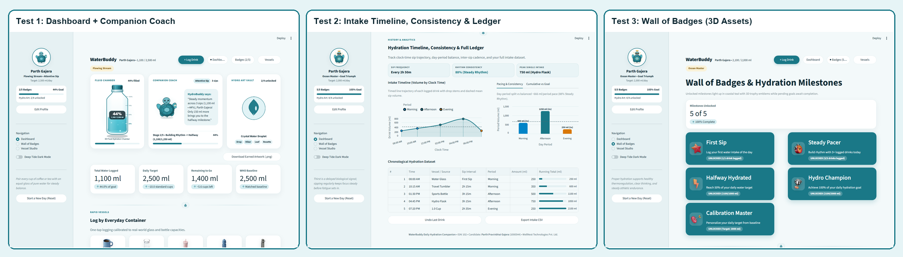
<p><em>Figure 6: Side-by-side live verification capturing Test 1 (3D Fluid Chamber & Reactive Turtle Coach), Test 2 (Intake Timeline Line Chart, Pacing & Consistency & Chronological Ledger), and Test 3 (5/5 3D Badges & 4-Piece Hydro Art Vault).</em></p>
</div>

---

## 12. Deployment & Local Installation Guide

### 12.1 Running Locally
```bash
# 1. Clone the repository
git clone https://github.com/parthibcpana/IDAI102-1000544-PARTH-PARVINBHAI-GAJERA.git
cd IDAI102-1000544-PARTH-PARVINBHAI-GAJERA

# 2. Create and activate a virtual environment
python -m venv venv
.\venv\Scripts\Activate.ps1    # Windows PowerShell
# source venv/bin/activate     # macOS / Linux

# 3. Install dependencies and launch
pip install -r requirements.txt
streamlit run app.py
```

### 12.2 Deployed Files for Streamlit Community Cloud
1. Ensure [app.py](app.py), [requirements.txt](requirements.txt), [.streamlit/config.toml](.streamlit/config.toml), `assets/`, and [README.md](README.md) are pushed to `main`.
2. Connect repository `parthibcpana/IDAI102-1000544-PARTH-PARVINBHAI-GAJERA` on [share.streamlit.io](https://share.streamlit.io/) with main file path `app.py`.

---

## 13. System Standards & Technical Alignment

| Requirement Area | Implementation Standard in WaterBuddy | Verification Outcome |
| :--- | :--- | :--- |
| **Age Cohort Calibration** | 4 WHO/EFSA cohorts (`1,600` to `2,500 ml/day`) plus live custom target override & 3D personas | Dynamically recalculates KPIs, fill %, and `Calibration Master` badge |
| **3D Fluid Visual Feedback** | 3D glass bottle with counter waves, meniscus, 5 bubbles, laser ticks + 5 mascots across 7 reactive states | Verified across `0%` to `210%` fills and all 35 mascot expressions |
| **Headless Turtle Engine** | In-memory `HeadlessTurtle` driving HydroBuddy SVG geometry + 4 `280x280` RGBA emblems | Zero PNG mascot dependency; zero Tkinter crashes in headless environments |
| **Low-Friction Logging** | Top `+ Log Drink` modal, 5 3D rapid vessels, interactive Vessel Studio, custom stepper, and Cup Converter | Verified sub-second updates across `AppTest` and live Chrome captures |
| **Timeline Analytics & Undo** | Clock-time Intake Timeline line graph, Period Pacing & Consistency chart, Cumulative vs Goal tab, `ProgressColumn` ledger, `Undo Last Drink`, and CSV export | Non-destructive undo restores totals, mascot mood, coach progression, and active artwork |
| **Dual Theme & Mobile Layout** | Native Coastal Oasis Light (`.streamlit/config.toml`) + Deep Tide Dark + `<=920px` CSS + synced sidebar/header tabs | Verified high legibility on desktop (`1420px`) and mobile (`412px`) |

---

## 14. Academic Integrity Statement

This submission comprises our complete Streamlit codebase ([app.py](app.py)), Streamlit theme config ([.streamlit/config.toml](.streamlit/config.toml)), dependency manifest ([requirements.txt](requirements.txt)), and documentation ([README.md](README.md)) built by **Parth Pravinbhai Gajera** (Candidate ID: `1000544`) and project partner **Subhan Syed** for **IDAI 102: Python Programming** at **Aspee Nutan Academy / WACP International** under the **WellNest Technologies Pvt. Ltd.** brief.

Foundational text-based starter routines were contributed by Subhan Syed, while the full Streamlit visual architecture, coastal waterfall welcome scene, animated SVG fluid chamber, five-avatar companion coach with over-hydration guardrails, custom container silhouettes, `+ Log Drink` modal workflow, cup converter, living wall of badges, in-memory Pillow `HeadlessTurtle` art vault, clock-time timeline and consistency analytics, light/dark dual palette system, and cloud deployment were engineered by Parth Pravinbhai Gajera in alignment with our FA-1 Canva visual atlas (`DAHars3Lfk4`).

**Student Developer:** Parth Pravinbhai Gajera (Candidate ID: `1000544`)  
**Project Partner:** Subhan Syed  
**Institution:** Aspee Nutan Academy / WACP International  
**Status:** Complete & Verified
